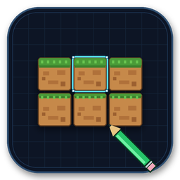
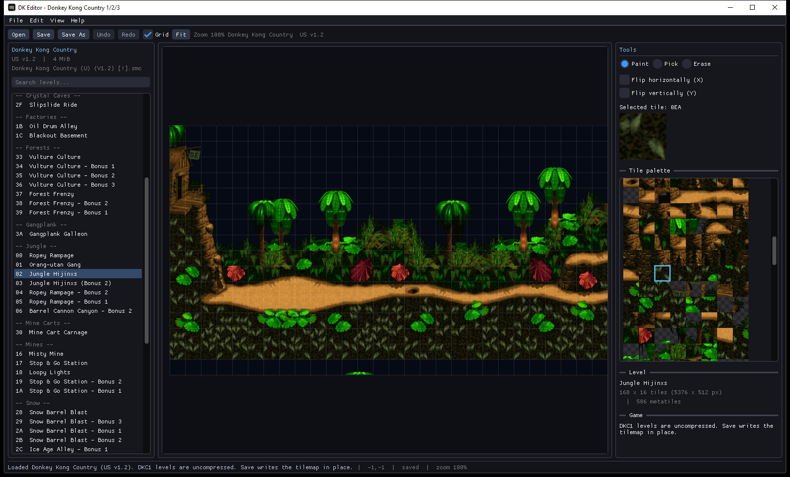

# DK Editor



A native Windows level editor for **Donkey Kong Country 1, 2 and 3** (SNES), inspired
by Lunar Magic. It opens clean 4 MiB HiROM dumps, lists the game's levels, renders the
terrain with the original graphics, and writes edits back to the ROM with a fixed
checksum.



## What works today

| Game | Open / detect | Level list | Terrain rendering | Terrain editing | Save ROM |
| --- | --- | --- | --- | --- | --- |
| DKC1 (US v1.2) | Yes | 65 stages and sub-rooms | Original tilesets, metatiles and palettes + themed sky | Paint, pick, erase, flip, undo/redo | In-place |
| DKC2 (US v1.1) | Yes | 192 stages and sub-rooms | Original tilesets, map chips and palettes + Layer 2 backgrounds | Paint, pick, erase, flip, undo/redo | Recompress + relocate |
| DKC3 (US v1.0) | Yes | 132 stages and sub-rooms | Background preview: real art for lakeside, mill, forest, riverbank, mountain, pipe and cave; themed gradient elsewhere | Stage settings / entrances | Direct |

### Backgrounds

- DKC2 renders the real Layer 2 scenery behind the terrain: the Ship Deck ocean
  and sky, Ship Mast clouds, Haunted Hall interior, ship-hold walls, brambles,
  honeycomb cells, forest trees, the carnival and the lava cave. Each theme is
  decoded from its Big Data tileset and 8x8 tilemap; index-0 pixels stay
  transparent so the sky gradient shows through.
- Very tall stages repeat the backdrop instead of stretching it, and the
  backdrop is dimmed slightly so the editable terrain stays readable.
- The scenery is decorative and read-only: painting, picking and erasing only
  ever touch the terrain tilemap, and a saved ROM keeps its original background
  data. Use the **Background** checkbox (or **View → Background scenery**) to
  hide it and work on terrain alone.
- DKC1 currently draws a themed sky gradient per level type (jungle, caves,
  snow, underwater, factories, and so on). Its Layer 3 artwork is still on the
  roadmap.

### DKC1

- Reads the uncompressed column-major (or row-major for vertical stages) tilemaps.
- Decodes DKC CHR tilesets, Map32 metatiles and 8x16 palettes from the ROM.
- Saves directly to the original level data slot, so no ROM expansion or
  relocation is required.

### DKC2

- Parses the level config table, level style records, submap tables and tilemap
  pointer tables.
- Decompresses Big Data tilesets, map chips and tilemaps with Kingizor's
  `dkcomp` (MIT).
- On save, recompresses the shared tilemap. If it no longer fits in its original
  slot, the editor finds a free zero-filled run, writes the new stream there and
  updates the tilemap pointer.
- Several DKC2 entries share a tilemap. Editing one of them edits the shared map;
  this is a property of the game, not a bug. Keep a backup when experimenting.

### DKC3

- Opens the ROM and lists the 132 configured stages, bonuses, bosses and water
  exit rooms.
- Edits music, start/midpoint/bonus/warp parameters and coordinates, parrot and
  Koin flags, and writes the changes back with a fixed checksum.
- Decodes and shows the real stage backdrop as a read-only preview for
  lakeside, mill, forest, riverbank, mountain, pipe and cave stages. The preview
  uses the stage's own FGBG palette and the DKC3 tilemap compression.
- Stages whose background art is not mapped yet (snow, factory, reef) show a
  themed gradient instead of a blank canvas.
- Terrain editing is the next milestone (see `TASKS.md`).

## Build

Requirements:

- Windows 10 or later
- Visual Studio 2022/2026 with the C++ desktop workload
- CMake 3.20 or newer

```bat
cmake -S . -B build -G "Visual Studio 18 2026" -A x64
cmake --build build --config Release
```

Or simply run `build.bat` from the repository root. If your Visual Studio version
uses a different generator name, run `cmake --help` and use the installed one.
The produced binaries are:

- `build\Release\DKEditor.exe`
- `build\Release\DKEditorSelftest.exe`

The build is self-contained. Dear ImGui and `dkcomp` are vendored under
`third_party/` with their MIT licences.

## Run

Double-click `DKEditor.exe`, then use **File > Open ROM...**, or pass a ROM path:

```bat
build\Release\DKEditor.exe "Donkey Kong Country (U) (V1.2) [!].smc"
```

An optional second argument selects a level by id (hex or decimal), for example
`... 0x2F` for Slipslide Ride.

Clean, headerless or 512-byte-headered 4 MiB ROMs are accepted. Saved files are
written headerless. The ROMs are copyrighted; they are not part of this
repository.

## Controls

| Action | Input |
| --- | --- |
| Pick an item | Click its icon in the item bar under the toolbar |
| Paint selected tile | Left click / drag (after picking a tile) |
| Erase tile | Right click / drag, or the Erase tool |
| Pick tile under cursor | Alt + left click, or the Pick tool |
| Select an area | **Select** tool, then drag (or drag with no tile picked, or `Shift`+drag) |
| Edit sprites | **Sprites** tool: click to select, drag to move, right-click to delete |
| Add a sprite | Pick an item in the item bar, then click empty canvas (DKC3) |
| Fill / clear / copy / paste area | Tools panel, `Delete`, `Ctrl+C`, `Ctrl+V` |
| Pan | Middle-drag, Space + left-drag, or the canvas scrollbars |
| Zoom | Mouse wheel |
| Fit level (press again to restore) | `F` or the **Fit** button |
| Toggle grid / scenery | **Grid** / **Background** checkboxes |
| Undo / redo | `Ctrl+Z` / `Ctrl+Y` |
| Open / save | `Ctrl+O` / `Ctrl+S` |
| Save as | `Ctrl+Shift+S` |
| Flip painted tile | **Flip horizontally/vertically** |

The right-hand tile palette shows every 32x32 metatile of the current level. Click
a cell to select it; nothing is selected when a level opens, so Paint stays idle
until you choose a tile. The **Select** tool draws a tinted, animated marquee
whose tiles can be filled, cleared, copied and pasted as one undo step each.

## Tests

The headless self-test loads all three ROMs, renders a level, edits and saves it,
reloads it, and verifies the checksum:

```bat
build\Release\DKEditorSelftest.exe ^
  "Donkey Kong Country (U) (V1.2) [!].smc" ^
  "Donkey Kong Country 2 - Diddy's Kong Quest (U) (V1.1) [!].smc" ^
  "Donkey Kong Country 3 - Dixie Kong's Double Trouble (U) [!].smc"
```

See `docs/TESTING.md` for the manual checklist.

## Documentation

- [docs/USAGE.md](docs/USAGE.md) - user manual
- [docs/ARCHITECTURE.md](docs/ARCHITECTURE.md) - code structure and data flow
- [docs/ROM_FORMATS.md](docs/ROM_FORMATS.md) - supported ROM structures
- [docs/BUILD.md](docs/BUILD.md) - detailed build instructions
- [docs/TESTING.md](docs/TESTING.md) - automated and manual tests
- [docs/CREDITS.md](docs/CREDITS.md) - reverse-engineering references and licences
- [TASKS.md](TASKS.md) - current status and roadmap
- [AGENTS.md](AGENTS.md) - contributor and AI-agent guide

## Legal

This is a fan-made editor. It does not include ROMs, extracted graphics, music or
other copyrighted game assets. Use it only with ROMs you legally own. Donkey Kong
Country and related names are trademarks of Nintendo/Rare. The editor source is
provided for research and modding purposes.

## License

The DK Editor source is MIT licensed; see [LICENSE](LICENSE). The vendored
libraries keep their own MIT licences under `third_party/`.
